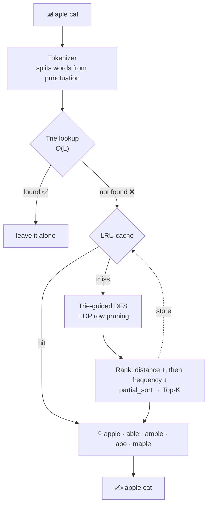

<div align="center">

```text
 _____ ____  ___ _____   ____ ___  _____  _     _
  |_   _|  _ \|_ _| ____| / ___|  _ \| ____| |   | |
    | | | |_) || ||  _|  | |   | | | |  _| | |   | |
       | | |  _ < | || |___ | |___| |_| | |___| |___| |___
        |_| |_| \_\___|_____| \____|____/|_____|_____|_____|
```

### Type `aple`. Get `apple`.
**A spell checker that doesn't read the whole dictionary to find your typo.**


</div>

---

## 🧭 The pitch

The textbook way to fix a typo is to compute the edit distance from your word to **every word in the dictionary** and sort the results. With 100,000+ words, that's 100,000+ dynamic-programming tables for a single typo.

**triecdell** takes a shortcut. It stores the dictionary in a **trie**, walks the tree while carrying **one DP row**, and the moment a branch can't possibly land within the edit-distance budget, it **cuts off the entire subtree**. Whole families of words are never even looked at.

Add a frequency-aware ranker and an LRU cache, and you get a spell checker + autocorrect engine in a few hundred lines of dependency-free C++20.

```text
spell-check> aple cat

Input Sentence: "aple cat"
------------------------------------------------------------
  [NOT FOUND] "aple" -> Suggestions: apple (d=1, freq=500000000) | able (d=1, freq=126000000) | ample (d=1, freq=120000000) | ape (d=1, freq=50000000) | maple (d=1, freq=9500000) [1628.3 us]
  [FOUND]  "cat" is spelled correctly.
------------------------------------------------------------
Autocorrected: "apple cat"
```

Cold search: about a millisecond. Same typo again: **about a microsecond**, straight from the cache.

---

## 🌳 How it thinks



### The dictionary is a tree

Every word is a path from the root. A `*` marks a node where a real word ends, and that node stores the word and its corpus frequency.

```text
(root)
 ├── a
 │   ├── m ── p ── l ── e*      ample
 │   └── p
 │       ├── e*                 ape
 │       └── p ── l ── e*       apple
 └── c ── a ── t*               cat
```

Exact lookup is just walking `L` edges: **O(L)**, independent of dictionary size.

### Pruning, in one picture

Searching for the typo **`aple`** with a budget of **2 edits**. Each step down the tree computes one new DP row. Each row has one cell per prefix of the target (`""`, `a`, `ap`, `apl`, `aple`).

```text
Path      DP row              min   verdict
────────  ──────────────────  ───   ───────────────────────────────────
a         [1, 0, 1, 2, 3]      0    keep going
ap        [2, 1, 0, 1, 2]      0    keep going
app       [3, 2, 1, 1, 2]      1    keep going
appl      [4, 3, 2, 1, 2]      1    keep going
apple     [5, 4, 3, 2, 1]      1    ✅ word, last cell = 1  →  "apple", d=1

z         [1, 1, 2, 3, 4]      1    keep going
ze        [2, 2, 2, 3, 3]      2    keep going (on the edge)
zeb       [3, 3, 3, 3, 4]      3    ✂️  PRUNED: min > 2, so zebra, zebras,
                                        zebrafish... are never visited
```

> If the **smallest** value in a row already exceeds the budget, extending the path can only keep it there or push it higher. So nothing below can match, and the whole subtree is skipped.

---

## 🎮 Four levels, one engine

The project is built as a ladder, and each level adds one idea on top of the last.

| Level | Name | What it does | Lives in |
| :---: | :--- | :--- | :--- |
| **1** | 🌱 **Plant the tree** | 26-way trie with frequency-weighted words. Exact lookup and prefix autocomplete. | [`include/trie.hpp`](include/trie.hpp) |
| **2** | 📏 **Measure the typo** | Levenshtein distance with a two-row DP (`O(N·M)` time, `O(min(N,M))` space). A Damerau variant with transpositions is included too. | [`include/edit_distance.hpp`](include/edit_distance.hpp) |
| **3** | 🏆 **Rank the answers** | Orders candidates by edit distance ascending, then corpus frequency descending, and keeps the Top-K via `std::partial_sort`. | [`include/spell_checker.hpp`](include/spell_checker.hpp) |
| **4** | ⚡ **Skip the work** | Trie-guided DP pruning (see above) plus a thread-safe LRU cache for repeated typos. | [`include/trie_searcher.hpp`](include/trie_searcher.hpp), [`include/lru_cache.hpp`](include/lru_cache.hpp) |

Supporting cast: [`include/tokenizer.hpp`](include/tokenizer.hpp) splits text into word and non-word tokens, and it preserves case when correcting (`HELLO wrld` → `HELLO world`).

---

## 📊 Does the pruning actually matter?

Yes. A sample run of `bin/benchmark` (g++ 13.3, `-O3`, 120k-word dictionary):

| Benchmark | Result |
| :--- | :--- |
| Exact trie lookup | **~62 ns** per lookup (~16 million lookups/sec) |
| Typo `aple`, naive full-dictionary DP scan | 17.456 ms |
| Typo `aple`, trie-guided DP with pruning | **0.767 ms** (≈ **22.8× faster**) |
| Repeated typo served from LRU cache | **~205 ns** per query, 100% hit rate |

<sub>Your numbers will vary with hardware and compiler. The naive baseline scans the first 100,000 words of the dictionary. Run it yourself with `./bin/benchmark`.</sub>

---

## 🚀 Quick start

You need a C++20 compiler. The build files use **g++** (developed and checked here with g++ 13).

**Linux / MSYS2**

```bash
git clone https://github.com/saquibkhan413/triecdell.git
cd triecdell
make                   # builds bin/spell_check and bin/benchmark
./bin/spell_check      # interactive shell
./bin/benchmark        # performance suite
```

**Windows (PowerShell + MinGW-w64)**

```powershell
.\build.ps1
.\bin\spell_check.exe
.\bin\benchmark.exe
```

**Want a double-clickable release for a friend's PC?**

```powershell
.\deploy_package.ps1   # → dist/ + spell_checker_v1.0_windows.zip
```

It produces a statically linked `spell_check.exe`, the dictionary, and a `run.bat` launcher.

> 💡 Run from the repo root: the dictionary path defaults to `data/dictionary.txt`. To use your own word list, pass it as the first argument: `./bin/spell_check path/to/words.txt`.

---

## 🖥️ The interactive shell

| Command | What it does |
| :--- | :--- |
| `<any sentence>` | Spell-checks every word and prints the autocorrected sentence |
| `word <token>` | Detailed ranked table: suggestion, edit distance, frequency, timing, cache hit or miss |
| `suggest <prefix>` | Trie autocomplete for a prefix |
| `add <word> [freq]` | Teaches the dictionary a new word (and clears the cache) |
| `stats` | Trie size, cache fill, hits, misses, hit rate |
| `demo` | Guided tour of everything above |
| `help` / `exit` | Does what it says |

---

## 📦 Use it as a library

It's header-only. Add `include/` to your include path and you're done.

```cpp
#include "spell_checker.hpp"
#include <iostream>

int main() {
    spell::SpellChecker sc;                          // LRU cache of 2000 entries by default
    sc.load_dictionary("data/dictionary.txt");       // one "word [frequency]" per line

    // Whole sentences
    auto r = sc.check_sentence("a computr algoritm test");
    std::cout << r.corrected_sentence << "\n";       // a computer algorithm test

    // Single words: top_k = 3, max_edit_distance = 2
    auto w = sc.check_word("aple", 3, 2);
    for (const auto& s : w.suggestions)
        std::cout << s.word << " d=" << s.edit_distance
                  << " freq=" << s.frequency << "\n";
    // apple d=1 freq=500000000
    // able  d=1 freq=126000000
    // ample d=1 freq=120000000

    // Teach it something new
    sc.insert_word("triecdell", 1000);
    std::cout << std::boolalpha << sc.is_word_correct("Triecdell") << "\n";   // true
}
```

**Dictionary format:** plain text, one entry per line as `word frequency`. The frequency is optional and defaults to 1. Lines starting with `#` are ignored.

---

## 🗺️ Project map

```text
triecdell/
├── include/                 header-only engine
│   ├── trie.hpp             26-way trie, insert / search / autocomplete
│   ├── edit_distance.hpp    Levenshtein + Damerau-Levenshtein
│   ├── trie_searcher.hpp    DP-row approximate search with subtree pruning
│   ├── lru_cache.hpp        thread-safe LRU cache with hit/miss stats
│   ├── tokenizer.hpp        word/non-word tokens + case preservation
│   └── spell_checker.hpp    the façade that ties it all together
├── src/
│   ├── main.cpp             interactive colour shell
│   └── benchmark.cpp        lookup / pruning / cache benchmarks
├── data/dictionary.txt      120,000 words with corpus frequencies
├── Makefile                 g++ build
├── build.ps1                Windows build
└── deploy_package.ps1       standalone Windows release + zip
```

---

## 🔍 Fine print

An honest tour of how it behaves, so nothing surprises you:

- **Letters only.** The trie is `a–z`. Text is split at anything that isn't a letter, so `don't` is treated as `don` + `t`. Digits, accents and apostrophes aren't supported yet.
- **Swapped letters cost two edits.** The trie search uses plain Levenshtein, so `recieve` is 2 edits from `receive`, and a rarer 1-edit word like `relieve` can outrank it. The Damerau-Levenshtein function (transpositions at cost 1) is already in `edit_distance.hpp`, but it isn't wired into the trie search yet.
- **No sentence context.** Words are corrected one at a time. In `Helo wrld`, `Helo` becomes `help` instead of `hello` because both are 1 edit away and `help` is more frequent.
- **Autocomplete order.** `suggest <prefix>` returns the first words found walking the trie alphabetically, not the most frequent ones.
- **Cache hygiene.** The LRU cache is mutex-guarded and is cleared whenever you add a word, so you never get stale suggestions.

## 🛣️ Roadmap

- [ ] Plug Damerau-Levenshtein into the trie search (`recieve` → `receive` at distance 1)
- [ ] Frequency-ranked autocomplete
- [ ] Bigram / context-aware ranking (`Helo wrld` → `hello world`)
- [ ] Unicode and apostrophe support
- [ ] Trim the long tail of low-frequency filler entries from the dictionary
- [ ] CMake build and CI

---

<div align="center">

Built with C++20, a lot of `unique_ptr`, and one very pruned tree 🌲✂️

by [@saquibkhan413](https://github.com/saquibkhan413)

</div>
